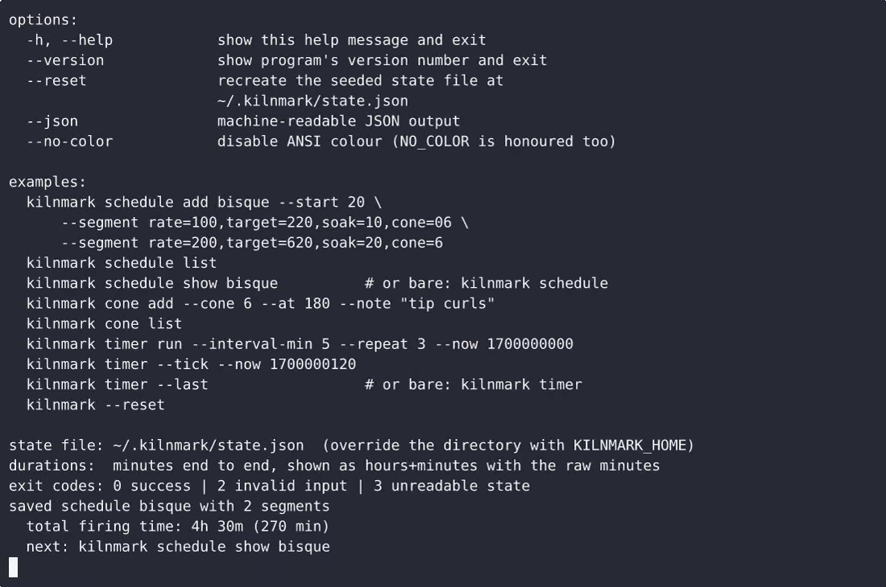
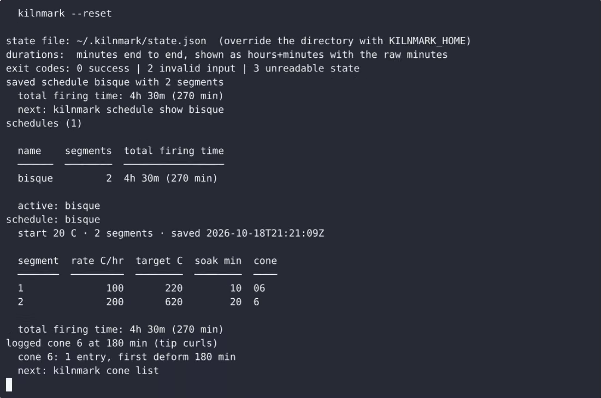

# Kilnmark — complete Full-stack app command-line tool example app

**Kilnmark** gives you two paths: self-host the Apache-2.0-licensed Full-stack app source as your own command-line tool, or [open it on cenius.ai](https://cenius.ai/marketplace/p/kilnmark?ref=gh&utm_campaign=kilnmark-webapp), describe the changes you want, and receive a new Kilnmark build with full rebrand rights. Kilnmark is a single-file, standard-library Python CLI that runs a wood-kiln firing: it stores named firing schedules made of ordered ramp segments, appends cone deformation observations during the fire, and runs a re…. Everything ships in this repo — no paywall, no hidden features, no separate Kilnmark download.


[](LICENSE)  [](https://cenius.ai)

[](https://cenius.ai/marketplace/p/kilnmark?ref=gh&utm_campaign=kilnmark-webapp)

> **▶ [Open & edit in cenius.ai](https://cenius.ai/marketplace/p/kilnmark?ref=gh&utm_campaign=kilnmark-webapp)** — one click to an editable workspace: describe changes in plain English, get an instant preview, one-click deploy and host. Modifications made on the platform come with full rebrand & relicense rights.

_Local clone? See [Quick start](#quick-start) below. cenius.ai is the zero-setup path._

## Demo


📽 **[Watch the walkthrough](https://cenius.ai/marketplace/p/kilnmark?ref=gh&utm_campaign=kilnmark-webapp)** — plays on cenius.ai · [MP4 file](.github/media/demo.mp4)

## Screenshots

 

## Quick start

```bash
./install.sh   # installs dependencies + seeds demo data
```

See [`INSTALL.md`](INSTALL.md) for full setup and usage instructions.

## Usage guide

Every command is one shot: it reads the state file, does its work, prints, and
exits. Nothing sleeps, nothing blocks, nothing needs a network.

Results go to **stdout**; errors and hints go to **stderr**. Exit codes are
`0` success, `2` invalid input, `3` unreadable state.

---

### 1. Firing schedules

#### Add a schedule

```sh
python3 kilnmark.py schedule add bisque --start 20 \
    --segment rate=100,target=220,soak=10,cone=06 \
    --segment rate=200,target=620,soak=20,cone=6
```

```
saved schedule bisque with 2 segments
  total firing time: 4h 30m (270 min)
  next: kilnmark schedule show bisque
```

- `--start` is the temperature the kiln is at when the firing begins
  (default `20` C).
- `--segment` is repeatable and the order you type them in is the order they are
  stored and shown.
- `rate` is C/hr, `target` is the temperature the segment climbs to, `soak` is
  minutes held at the target, `cone` is an optional label.

The total is derived, never stored:

```
total_minutes = Σ over segments of ((target − previous_target) / rate) × 60 + soak
previous_target for segment 1 = --start
```

So the example is `(220−20)/100×60 + 10 = 130` plus `(620−220)/200×60 + 20 = 140`
— **270 minutes**.

#### List every schedule

```sh
python3 kilnmark.py schedule list
```

```
schedules (2)

  name    segments  total firing time
  ──────  ────────  ──────────────────
  bisque         2  4h 30m (270 min)
  glaze          2  19h 10m (1150 min)

  active: glaze
```

#### Show one schedule

_Full guide: [`USAGE.md`](USAGE.md)_

## Features

- Firing schedule
- Cone deformation log
- Stoke interval timer

## Architecture

Everything runs out of the box: a Full-stack app codebase (23 files). `install.sh` takes care of packages and initial data in a single pass; nothing else is required before launching. Top-level layout: `tests/`. Installation walkthrough: [`INSTALL.md`](INSTALL.md).

## FAQ

### How do I get Kilnmark running locally?

`git clone` + `./install.sh` gets you a running instance — the install script provisions dependencies and demo data. Full steps live in [`INSTALL.md`](INSTALL.md); nothing external is needed to try it.

### What powers Kilnmark under the hood?

The app is built with Full-stack app. What you see in this repo is the full production source, demo data included. Highlights include cone deformation log.

### Is there a no-code way to modify Kilnmark?

Describe what you want changed on [cenius.ai](https://cenius.ai/marketplace/p/kilnmark?ref=gh&utm_campaign=kilnmark-webapp) — no code editing needed; the platform produces a fresh build you can download and deploy.

### Is it possible to white-label Kilnmark for a client?

Rebranding is straightforward under the MIT license — change what you want in the source. Or [open it on cenius.ai](https://cenius.ai/marketplace/p/kilnmark?ref=gh&utm_campaign=kilnmark-webapp): the platform handles the changes and grants full rebrand rights on the result.

### Is Kilnmark free for commercial use?

Confirmed free for commercial use — MIT terms let you incorporate, resell, or ship it in any product. [LICENSE](LICENSE).

## License & rebranding

Released under the [Apache License 2.0](LICENSE) (© 2026 Cenius AI) — free for personal and commercial use. The Cenius name/logo are trademarks (see NOTICE).

**Need a customized version?** [Remix this app on cenius.ai](https://cenius.ai/marketplace/p/kilnmark?ref=gh&utm_campaign=kilnmark-webapp) — modifications made on the platform come with **full rebrand & relicense rights** over your derivative.

## Built with cenius.ai

This entire application — code, design, seeded demo data — was generated on **[cenius.ai](https://cenius.ai)** from a plain-English description.

- 🚀 [Build your own app on cenius.ai](https://cenius.ai)
- 🎛️ [Remix Kilnmark on the marketplace](https://cenius.ai/marketplace/p/kilnmark?ref=gh&utm_campaign=kilnmark-webapp) — open it in a workspace, prompt for changes, and ship your own version.

More open-source apps: [the Cenius-ai catalog](https://github.com/Cenius-ai) · [showcase index](https://github.com/Cenius-ai/showcase)
